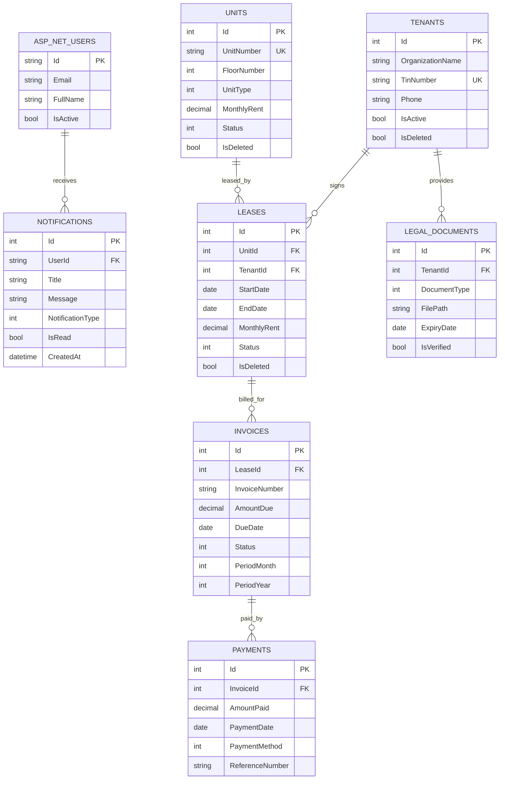

# Entity relationship diagram

`ASP_NET_USERS` represents the ASP.NET Core Identity user table (`AspNetUsers`). Base entity audit and soft-delete columns are omitted from this diagram for readability.
